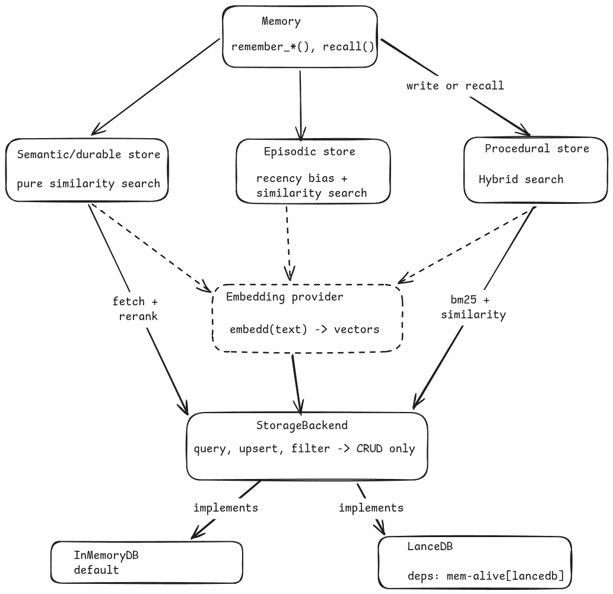

# mem-alive

[](https://pypi.org/project/mem-alive/)

A memory layer for AI agents. Semantic, episodic, and procedural memory, built as a Python package.

## Why

Coding agents re-read the whole codebase every time they start a task. That burns tokens and adds round trips between the cloud model and the local harness. This library exists to fix that by giving agents actual memory instead of a blank slate every session.

That said, it's not built just for coding agents. It's a general memory layer that works with any agentic setup or a plain RAG app. The coding-agent problem is the flagship test case, not something baked into the core.

## Architecture



The diagram shows the v0.1 baseline. One `Memory` client fronts three stores, each backed by the same pluggable `StorageBackend` and `EmbeddingProvider`. The v1 candidate adds separate ingestion and document paths, described in [v1 architecture](docs/v1-architecture.md).

## Three kinds of memory

- **Semantic** - durable facts, no recency weighting. Corrections update a record by ID.
- **Episodic** - specific past events, timestamped, recency-weighted (exponential half-life decay), never merged.
- **Procedural** - skills and workflows, retrieved by hybrid search (embedding similarity + keyword overlap).

Each type has its own store with its own retrieval logic, but all three share one schema and one `memory_type` tag, so a single federated `recall()` on the `Memory` client can query across all of them at once.

## Scoping

- `namespace` - hard partition, never crossed. Means whatever the caller wants (agent, repo, tenant).
- `metadata` - flexible filters within a namespace (session id, tags, etc).

## Corrections

Vector similarity does not prove contradiction. `remember()` preserves both similar facts; use `update(namespace, memory_id, fact)` when a known record needs correction. Add, update, and delete operations have inspectable history. Conversation extraction is available through `ingest`; automatic contradiction decisions are not implemented yet.

## Storage

The backend stays dumb: vector search, metadata filters, CRUD, nothing else. Recency decay, hybrid scoring, and contradiction logic all live above it, in the store layer, so any backend stays swappable.

`InMemoryBackend` is useful for development and tests. `SQLiteBackend` persists records and their history, supports namespace-scoped browsing and exact vector search, and can create a consistent backup. Its search scans one namespace, so it is intended for personal-sized collections.

## Local use

Run Ollama with the `embeddinggemma` model, then:

```python
import asyncio
from pathlib import Path

from mem_alive import LocalEmbeddingProvider, Memory, SQLiteBackend


async def main():
    db = SQLiteBackend(Path.home() / ".local/share/mem-alive/memory.db")
    async with LocalEmbeddingProvider() as embedder:
        memory = Memory(embedder, db)
        saved = await memory.remember("semantic", "personal", "I prefer Python", {"source": "me"})
        hits = await memory.recall_hits("personal", "Python preference", {})
        await memory.update("personal", saved.id, "I prefer Rust")
        print(hits)


asyncio.run(main())
```

`get`, `list`, `history`, `delete`, and `forget` provide the rest of the record lifecycle. `delete` preserves audit history; `forget` purges the record and its local history. `SQLiteBackend.backup(path)` writes a new, consistent backup file; it refuses to overwrite an existing file. Keep the database and backup path private because neither is encrypted.

## Use from an agent

The `mem-alive` command prints JSON so an agent can call it across sessions. A namespace is required for every command:

```bash
mem-alive --namespace personal remember semantic "I prefer Python"
mem-alive --namespace personal recall "What language do I prefer?"
printf '[{"role":"user","content":"I prefer dark mode in coding tools."}]' \
  | mem-alive --namespace personal ingest
mem-alive --namespace personal list
mem-alive --namespace personal backup ~/memory-backup.db
```

The CLI uses local Ollama models `embeddinggemma` and `llama3.2` by default. `MEM_ALIVE_DB` selects the SQLite file; otherwise it uses `$XDG_DATA_HOME/mem-alive/memory.db` or `~/.local/share/mem-alive/memory.db`. Conversation ingestion records source message indices and hashes by default. Pass `ingest --store-source-text` only when retaining the original user text is necessary.

With `pip install mem-alive[pageindex]`, `index-pdf`, `ask-doc`, `list-docs`, and `forget-doc` use PageIndex's local text-PDF mode. Documents are stored under a directory scoped to the namespace. The adapter requires a PageIndex page citation or a unique source-text match for an uncited numeric answer. Scanned PDFs need PageIndex Cloud or another OCR step.

## Status

The published version is 0.1.1. This branch adds local durability, explicit correction, conversation extraction, PageIndex document retrieval, and a CLI. Its small live Ollama evals pass, but broader personal-document and workflow evaluation remain before a v1 claim. See [v1 architecture](docs/v1-architecture.md), [operations](docs/operations.md), and the [agent workflow](docs/agent-workflow.md) for decisions and release gates. MIT licensed.
